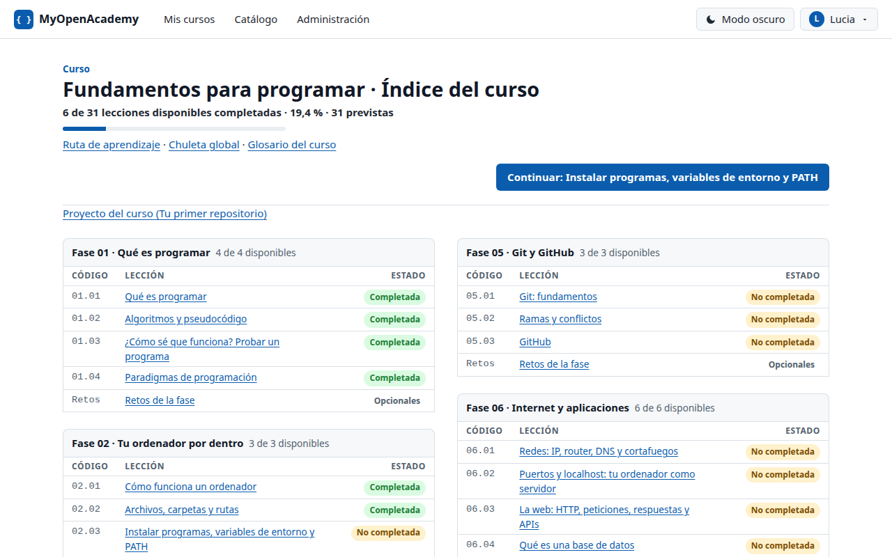
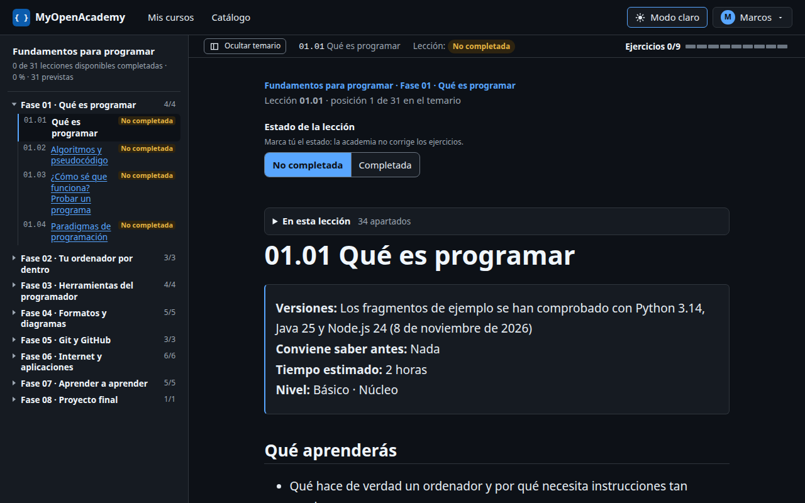
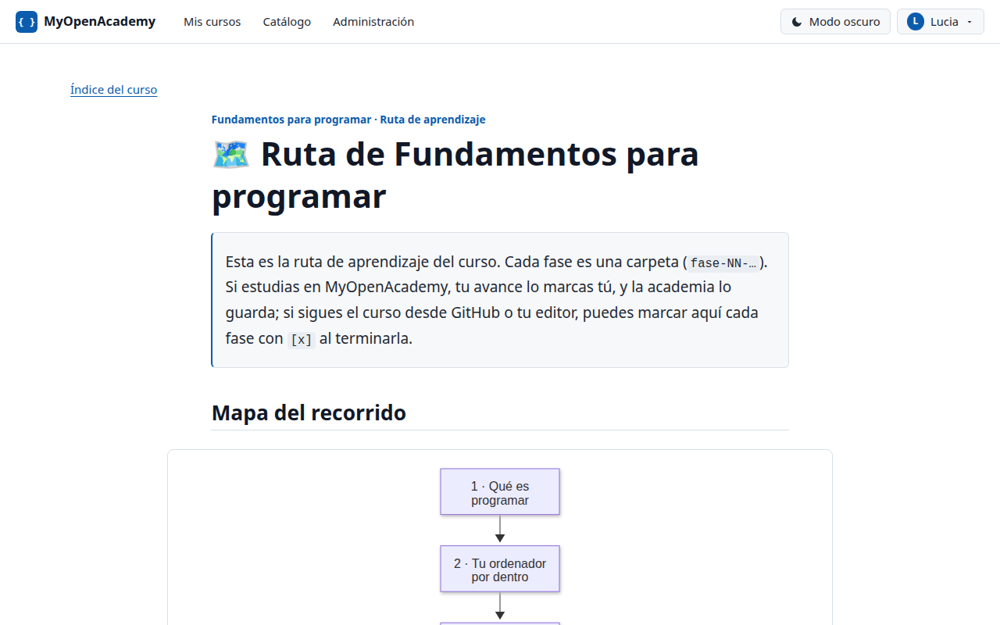
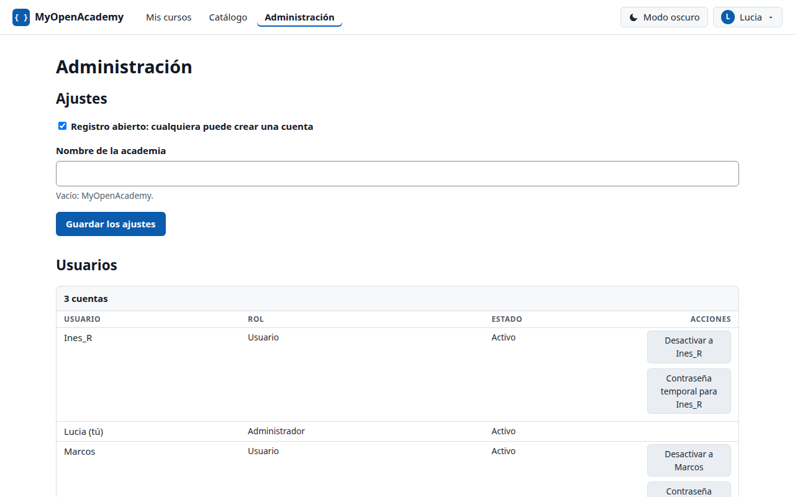
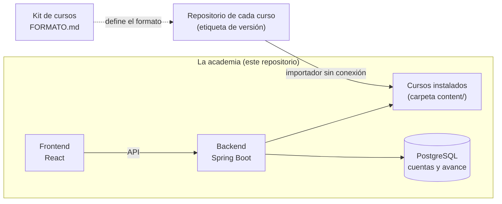

# MyOpenAcademy

*A free, open-source programming academy that works like a game with DLC: the platform is the game, and each course is an expansion you install by its version. This repository is the platform (React, Spring Boot, PostgreSQL). Version 1.0, the base pack, comes with one course, «Fundamentos para programar» (programming fundamentals). Everything is in Spanish from here on.*

Academia de programación **libre, gratuita y de código abierto**, pensada como un juego con DLC: **la academia es el juego y cada curso es una expansión** que se instala con su versión. La instalas en tu equipo o en la red de casa, añades los cursos que quieras y cada alumno lleva su propio avance.

El **pack base 1.0** es la academia más el curso inicial, «Fundamentos para programar»: lo que conviene saber antes de cualquier curso (qué es programar, tu ordenador, la terminal, Git y GitHub, los formatos de datos, internet y cómo aprender).

**Estado:** versión 1.0.0, el pack base. Ver el [registro de cambios](CHANGELOG.md).

| | |
|---|---|
|  |  |
| Una lección, en modo oscuro | La ruta de aprendizaje del curso |

*Capturas de una instalación de prueba, con cuentas inventadas.*

## Cómo encaja todo

La academia no lee los cursos en directo: el importador los copia desde su repositorio, por su etiqueta de versión, a la carpeta de cursos instalados, y el backend los sirve desde allí. La base solo guarda las cuentas, los ajustes y el avance de cada alumno.

## Qué hace

- **Cursos como DLC.** La academia arranca vacía y los cursos se instalan desde su repositorio, por su etiqueta de versión, con un importador sin conexión que compara los cambios antes de aplicarlos y conserva el avance de los alumnos. Ningún curso está escrito en el código: todo sale de los cursos instalados.
- **Lecciones completas:** ejercicios con pistas y soluciones, preguntas de repaso, diagramas, código resaltado y con botón de copiar, imágenes y carpetas de código descargables como ZIP. Además, los retos de cada fase, el glosario, la ruta de aprendizaje, la chuleta global y el proyecto del curso.
- **Tu avance:** cada alumno marca sus lecciones, ejercicios y etapas, ve su progreso en «Mis cursos» y continúa donde lo dejó.
- **Administración:** registro abierto o cerrado, nombre de la academia, cuentas (desactivar, contraseña temporal) y cursos instalados.
- **Modo claro y oscuro**, modo de lectura sin distracciones y páginas que se imprimen bien.

## Hoja de ruta

Después del pack base vienen más cursos, cada uno como un DLC con su versión:

1. **Java**, el primer DLC: empieza donde acaba el curso inicial.
2. Después, orientativos: **SQL** y **Git y GitHub a fondo**.

## Instalar

Con Docker Compose, en un solo comando. Paso a paso, con la configuración, el administrador, los cursos y el uso en la red de casa: [`docs/instalacion.md`](docs/instalacion.md).

## Los cursos

Cada curso vive en su propio repositorio y cumple un formato común, que define qué tiene que traer para que la academia lo instale. Cuando se publiquen, estarán en la organización `myopenacademy` de GitHub:

- **El curso inicial**, «Fundamentos para programar»: <https://github.com/myopenacademy/curso-inicial>.
- **El kit de cursos**, con el formato (`FORMATO.md`) y las herramientas para escribir y comprobar un curso: <https://github.com/myopenacademy/kit-cursos>.

Si quieres escribir un curso, empieza por el formato. Para probar la academia mientras tanto, este repositorio trae dos cursos de ejemplo pequeños en [`cursos-ejemplo/`](cursos-ejemplo/).

## Desarrollar

Requisitos, configuración y arranque en local: [`docs/desarrollo-local.md`](docs/desarrollo-local.md). Las pruebas:

- En `backend/`, con Docker activo: `./mvnw -B verify` (usa una base de datos desechable).
- En `frontend/`: `npm run test -- --run`, `npm run lint` y `npm run build`.
- En el navegador, con su propia base, backend y cursos de ejemplo: `npm run test:e2e` desde `frontend/`.

**Tecnologías:** React 19, Vite y TypeScript en el frontend; Java 25 y Spring Boot 4.1 en el backend; PostgreSQL 18; Mermaid 12.3 para los diagramas. Vitest, Testing Library y Playwright para las pruebas.

## Documentación

- [Instalación](docs/instalacion.md) y [desarrollo local](docs/desarrollo-local.md).
- [Instalar y actualizar cursos](docs/actualizacion-contenido.md), [manifiesto de contenido](docs/manifiesto.md) y [contrato de la API](docs/api.md).
- [Frontend](frontend/README.md) y [licencias de las dependencias](docs/licencias.md).
- [Plan e hitos](PLAN.md).

## Cómo se ha hecho

La academia se ha escrito con ayuda de asistentes de IA, por hitos y con pruebas en cada uno. Cada decisión y cada cambio los ha revisado y aprobado el autor antes de integrarlos. El registro del trabajo está en el propio repositorio: las reglas en [`CLAUDE.md`](CLAUDE.md), el plan en [`PLAN.md`](PLAN.md), el estado y las decisiones en [`ESTADO.md`](ESTADO.md) y las tareas de cada hito, con sus pruebas, en [`odd/tasks/`](odd/tasks/).

## Contribuir y licencia

Toda ayuda cuenta: lee [`CONTRIBUTING.md`](CONTRIBUTING.md). Si encuentras una errata en una lección, usa «Mejorar esta lección», que lleva al repositorio del curso.

Código con licencia **MIT** ([`LICENSE`](LICENSE)), a nombre de Santiago (santi-cast). Cada curso lleva su propia licencia.
