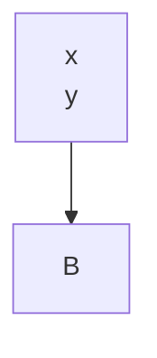

# 01.01 Introducción

> **Requisitos previos:** [02.01 Pendiente](../fase-02/01-pendiente.md#algo-que-no-existe)

## Qué aprenderás

Ver [la sección repetida](#repetida-1), [la siguiente lección](02-siguiente.md#sección-b), [el ejercicio 2](#ejercicio-2--segundo-ejercicio) y el [índice](../00-indice.md).

## Repetida

Texto de cuerpo.

## Repetida

📁 **Código:** [`codigo/hola/`](codigo/hola/) y el fichero [Solo.java](codigo/solo/Solo.java). Más en [la web](https://dev.java/learn/).

---

## 5. Ejercicios prácticos resueltos

### 🟢 Básico

#### Ejercicio 1 · Primer ejercicio

Enunciado uno con [código](codigo/solo/).

Ver solución

Solución uno, vuelve a [Repetida](#repetida).

#### Ejercicio 2 · Segundo `ejercicio`

Enunciado dos.

Ver solución

Solución dos.

---

## 6. Chuleta

Final del cuerpo.
