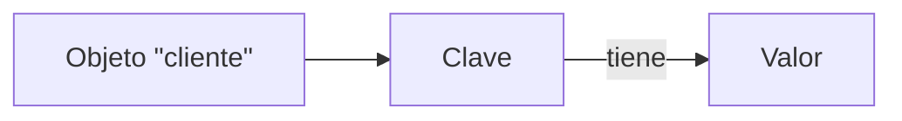

# 01.01 Ficheros JSON

> **Versiones:** ninguna en especial (JSON es un estándar, RFC 8259)
> **Conviene saber antes:** [Mi primer repositorio, 1.1](https://github.com/myopenacademy/ejemplo-destino/blob/main/fase-01-tu-primer-proyecto/01-mi-primer-repositorio.md#11-qué-es-un-repositorio) · [el índice](../00-indice.md)
> **Tiempo estimado:** 2 horas
> **Nivel:** Básico · Núcleo

## Qué aprenderás

- Qué es un fichero JSON y para qué sirve.
- Cómo se escriben objetos y listas.

## 1. Teoría

### 1.1. Qué es JSON

JSON guarda datos como texto, por ejemplo los de un [repositorio](https://github.com/myopenacademy/ejemplo-destino/blob/main/glosario.md#repositorio). Lo verás también en [Ficheros YAML](02-ficheros-yaml.md), cuando esté.




El diagrama dice lo mismo en texto: un objeto tiene claves, y cada clave, un valor.

### 1.2. Objetos y listas

Un objeto va entre llaves; una lista, entre corchetes. Pulsa <kbd>Ctrl</kbd> + <kbd>S</kbd> para guardar.

## 2. Ejemplos de código

### 2.1. Un cliente

```json
{"nombre": "Ana", "puntos": 120}
```

📁 **Código:** [`codigo/01-ficheros-json/ejemplos/2.1-un-cliente/`](codigo/01-ficheros-json/ejemplos/2.1-un-cliente/)

### 2.2. Contar clientes

Un script que cuenta los clientes de una ciudad (lo usarías para un informe rápido):

```bash
#!/bin/bash
# Cuenta los clientes de una ciudad en clientes.json (una lista con un cliente por línea)
ciudad="$1"
total=$(grep -c "\"ciudad\": \"$ciudad\"" clientes.json)
echo "Clientes de $ciudad: $total"
```

📁 **Código:** [`codigo/01-ficheros-json/ejemplos/2.2-contar-clientes/`](codigo/01-ficheros-json/ejemplos/2.2-contar-clientes/)

**Salida:**

```text
Clientes de Madrid: 2
```

### 2.3. Ver un fichero en la terminal

**En tu terminal** (`sesion.txt`):

```text
$ ls
cliente.json
$ cat cliente.json
{"nombre": "Ana", "puntos": 120}
```

📁 **Código:** [`codigo/01-ficheros-json/ejemplos/2.3-ver-un-fichero/`](codigo/01-ficheros-json/ejemplos/2.3-ver-un-fichero/)

### 2.4. Preguntar a una API con curl

Una API devuelve JSON. `curl -i` enseña también la línea de estado y las cabeceras de la respuesta:

**En tu terminal** (`sesion.txt`):

```text
$ curl -i http://localhost:8080/clientes/1
HTTP/1.1 200 OK
Content-Type: application/json
Content-Length: 39

{
  "nombre": "Ana",
  "puntos": 120
}
$ curl -s http://localhost:8080/clientes/7
{
  "error": "No existe la ruta /clientes/7"
}
$ curl -s -o clientes.json http://localhost:8080/clientes
$ ls
clientes.json
```

📁 **Código:** [`codigo/01-ficheros-json/ejemplos/2.4-preguntar-a-una-api/`](codigo/01-ficheros-json/ejemplos/2.4-preguntar-a-una-api/)

## 3. Errores típicos

### 3.1. La coma de más

Una coma después del último elemento hace que el fichero no sea válido.

## 4. Buenas prácticas

- Usa nombres de clave claros.

## 5. Ejercicios prácticos resueltos

### 🟢 Básico

#### Ejercicio 1 · Un pedido de la tienda

Escribe un pedido con su número y su total.

<details>
<summary>Pista 1</summary>

Es un objeto con dos claves.

</details>

<details>
<summary>Ver solución</summary>

```json
{"pedido": 1, "total": 25.5}
```

📁 **Código:** [`codigo/01-ficheros-json/ejercicios/ej01-un-pedido/`](codigo/01-ficheros-json/ejercicios/ej01-un-pedido/)

<details>
<summary>Ver el pedido con <code>total</code> en céntimos</summary>

```json
{"pedido": 1, "total": 2550}
```

</details>

</details>

### 🟡 Intermedio

#### Ejercicio 2 · La coma de más

Encuentra el error de `{"a": 1,}`.

<details>
<summary>Pista 1</summary>

Mira el final.

</details>

<details>
<summary>Ver solución</summary>

Sobra la coma del final: lo explica [3.1](#31-la-coma-de-más).

</details>

### 🔴 Avanzado

Este módulo no tiene ejercicios avanzados todavía.

### 🏆 Caso real

Tampoco tiene caso real.

## 6. Chuleta

### Tipos de valores

| Tipo | Ejemplo |
|---|---|
| Texto | `"hola"` |

## 7. Preguntas de repaso

1. ¿Qué rodea a un objeto JSON?

   <details>
   <summary>Ver respuesta</summary>

   Las llaves. Lo tienes en [1.2. Objetos y listas](#12-objetos-y-listas).

   </details>

---
⬅️ [Índice](../00-indice.md) · 📚 [Índice](../00-indice.md) · ➡️ [Siguiente: Retos de la fase](retos.md)
